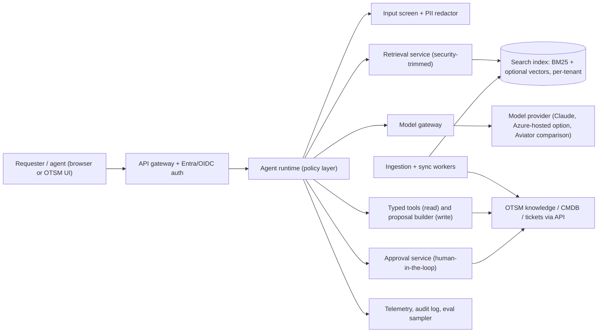
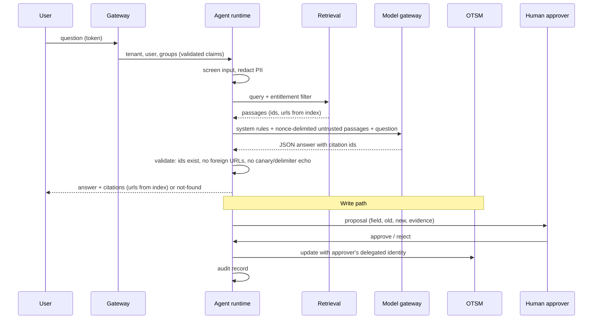
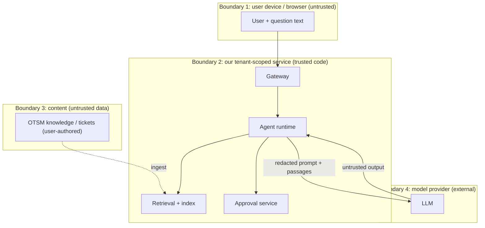
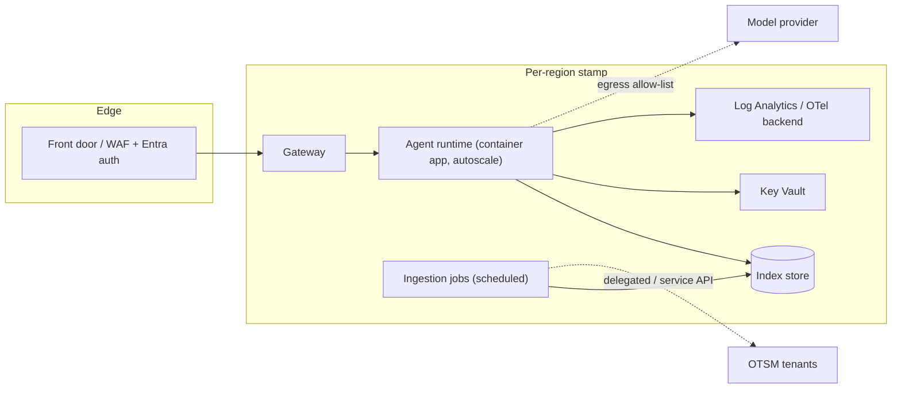
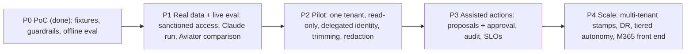

# Part 2: Target architecture for OpenText Service Management

**Status:** design proposal. It extends the working PoC (Part 1) and is **not implemented**. I have not used OpenText Service Management's APIs or admin surfaces; every statement about its internals is an **ASSUMPTION** (marked) to be confirmed with the product team.

## 0. Summary

Expand the PoC from "answer questions from support articles" to "help service-desk users and requesters inside OpenText Service Management (OTSM)": answer from approved knowledge, deflect or speed up tickets, summarise, and, behind explicit human approval, propose changes to records.

Core design choices (rationale in Sections 4 to 12 and ADR-0008):

1. **A policy-enforcing agent runtime sits between the model and everything else.** Safety rules live in code (as in the PoC), not in prompts.
2. **Acts on behalf of the signed-in user.** The agent never has more access than the person asking. Retrieval is security-trimmed at query time.
3. **Read by default; writes are proposals.** Any record change is a typed, validated proposal that a human approves.
4. **Model behind a gateway.** Provider is swappable; OpenText's own Aviator virtual agent is the first thing to compare against, not to ignore (Section 11).
5. **Evaluation gates releases.** The PoC's deterministic harness becomes a CI gate plus live sampling in production.

What the PoC already proves (offline, synthetic data): id-only citations, forced not-found, injection screening and output validation, safe stale-record sweep, and an eval harness. What it does not prove: anything about real content, real users, real Claude output (`docs/evaluation.md`).

## 1. Assumptions (explicit)

| # | Assumption | If wrong |
|---|---|---|
| A1 | OTSM exposes REST APIs for requests/incidents/knowledge/CMDB and a generic API connector (OpenText product pages describe an API connector; I did not verify endpoints, auth or rate limits). | Fall back to export/event feed; integration effort rises. |
| A2 | OTSM can authenticate API calls on behalf of a user (OAuth/OIDC delegation) or accept a service identity plus a user claim. | Without per-user delegation I must replicate entitlements in my index (harder, riskier). |
| A3 | OTSM knowledge articles carry visibility rules (audience/group/tenant) readable via API. | Cannot security-trim; restrict scope to public knowledge only. |
| A4 | The customer's identity provider is Entra ID or federates to it. | Substitute the IdP; design unchanged. |
| A5 | Customers may require data residency and a "no data leaves tenant/region" option. | Drives model-hosting options (Section 11). |
| A6 | OpenText Aviator already provides a virtual agent in OTSM, described publicly as using a private LLM by default and grounded in approved knowledge. | The build-vs-extend answer changes (ADR-0008, D8). |
| A7 | Ticket text contains personal data and sometimes secrets pasted by users. | Redaction scope grows. |
| A8 | The support-content access boundary is as in ADR-0002: live support content is behind an authenticated portal; sanctioned access (service API, export, or delegated OAuth) is required. | Part 1 stays fixture-only. |

## 2. Requirements and non-goals

**Functional:** grounded answers with citations; "not found" instead of guessing; ticket summarisation and similar-incident lookup; draft replies; proposed field updates (category, priority, assignment) with approval; multi-tenant.

**Quality targets (suggested, to be agreed):** p95 answer latency under 8 s for a search-and-answer turn; availability 99.5% for the agent API in PoC-to-pilot, higher only after the dependency picture is known; unsafe-output rate 0 on the adversarial set; citation validity 100% by construction.

**Non-goals (initially):** autonomous writes, cross-tenant search, free-form tool use against arbitrary systems, training or fine-tuning on customer data.

## 3. Application components

| Component | Responsibility | PoC lineage |
|---|---|---|
| API gateway | TLS, authn (OIDC), rate limits per user and tenant, request size caps | PoC has none (gap) |
| Agent runtime | Orchestrates one turn; enforces nonce delimiters, canary, id-only citations, forced not-found, output validation; owns the tool allow-list | `ota.agent` |
| Input screen / redactor | Reject known injection patterns; mask personal data and secrets before text leaves the trust boundary | `screen_input`; redactor is new |
| Retrieval service | BM25 (default) with entitlement filter applied in the query, not after | `ota.retrieval`; filter is new |
| Index | Per-tenant, with ACL metadata per record | SQLite FTS5 today; managed search or Postgres FTS later |
| Ingestion / sync | Incremental pull, idempotent upsert, source-scoped deletion sweep with mass-removal guard | `ota.ingest` |
| Model gateway | Provider abstraction, retries, timeouts, budgets, token accounting, egress allow-list | `ModelClient` interface |
| Tools | Read-only typed tools; write tools only produce proposals | `search_support_content`, `lookup_product` |
| Approval service | Shows the human the proposal and evidence, records decision, executes with the **approver's** delegated identity | new |
| Telemetry and audit | Structured logs, traces, metrics, immutable audit of every proposal and decision | `ota.obs` |

## 4. Identity and access

**Principle:** the agent's authority is the intersection of (the user's rights) and (the agent's allow-listed tools). It must never exceed the user's.

- **Users:** Entra ID (or federated IdP) via OIDC at the gateway. Tenant and user id come from validated token claims, never from the request body or from model output.
- **Calls to OTSM:** delegated. Preferred: OAuth on-behalf-of the user (A2). Fallback: a service identity per tenant that sends the user's identity as a claim and is trimmed server-side (weaker; needs OTSM to honour it).
- **Workload identity:** managed identity for the runtime; secrets from a vault; no long-lived keys (as in ADR-0007).
- **Agent identity:** register the agent as its own principal with an owner/sponsor and lifecycle. In a Microsoft 365 estate, Entra Agent ID and Agent 365 are the intended governance plane; availability for a non-Microsoft agent is unconfirmed (see `docs/m365-copilot-readiness.md`, Sections 7 and 8).
- **Security trimming:** each index record carries an ACL (groups/tenant/audience from A3). The query includes `tenant = :t AND acl && :user_groups`. Trimming after retrieval is rejected: it leaks existence through counts, ranking and latency.
- **Why the access boundary matters:** ADR-0002 records that live support content sits behind authenticated sessions. A shared index built with a service account would silently widen access to every user of the agent. Either index per entitlement set, or federate at query time with the user's token (ADR-0008, D3).
- **Admin and support access:** break-glass, time-boxed, audited; no standing access to tenant content for operators.

## 5. Data flow

Data classes in flight: user question (may hold personal data), retrieved passages (customer content), model output, proposals, audit records. Passages and questions are the data that leave for the model provider; Section 8 covers this.

## 6. Model interaction

Carried over from the PoC (all enforced in code, `ADR-0004/0005`):

- Retrieved text is untrusted data, wrapped in per-request random delimiters; the system prompt says to treat it as data.
- A canary string detects system-prompt leakage; delimiter echo is rejected.
- The model returns citation **ids**; URLs are looked up in the index. A foreign URL or unknown id rejects the answer.
- Nothing retrieved means a forced not-found; the model is not asked.
- Tools are typed and read-only. The model cannot call a write.

New for OTSM:

- **Write path:** the model may emit a *proposal object* (schema-validated: field allow-list, value allow-list or regex, target record id from the retrieved context). The runtime renders it for a human; it is never executed from model text.
- **Output rendering:** treat output as untrusted when displayed (escape; no markdown images or auto-links to non-index hosts), to close data-exfiltration-by-rendering.
- **Budgets:** per-turn token and tool-call caps, per-tenant daily spend caps (unbounded consumption).
- **Open item (documented, not built; ADR-0006):** strip vs reject invalid citations, and quarantine at ingestion. Decide with live evidence.

## 7. Trust boundaries

Rules at each crossing: B1 to B2 authenticate, cap size, rate-limit. B3 to B2 treat as data, never instructions; label and delimit. B2 to B4 send only what the task needs, redacted, over an allow-listed egress; log metadata, not content, by default. B4 to B2 validate before use. Model output never crosses into B3 (writes) without the approval service.

## 8. Security and privacy

**Threat mapping (OWASP Top 10 for LLM Applications, 2025):**

| ID | Risk | Control in this design | Status |
|---|---|---|---|
| LLM01 | Prompt injection (direct and indirect via tickets/articles) | Nonce delimiters, input screen, output validation, no write tools, human approval | PoC: implemented and measured offline; mitigated, not solved |
| LLM02 | Sensitive information disclosure | Entitlement trimming, redaction before the model, no cross-tenant index, log minimisation | Design |
| LLM03 | Supply chain | Pinned dependencies, SCA and image scans in CI, model/provider review | CI written, unvalidated |
| LLM04 | Data and model poisoning | Provenance per record, source-scoped sync, quarantine of injection-like records (future work) | Partly; quarantine not built |
| LLM05 | Improper output handling | Schema-validated proposals, escaped rendering, no execution of model text | PoC for answers; proposals new |
| LLM06 | Excessive agency | Read-only tools, proposals only, approver's identity executes, per-tool allow-list | Design |
| LLM07 | System prompt leakage | Canary check; no secrets in prompts | PoC |
| LLM08 | Vector and embedding weaknesses | Per-tenant indexes, ACL filter inside the query, BM25 default | Design; ACL filter new |
| LLM09 | Misinformation | Citations, not-found path, stale-source warnings, eval of unanswerable questions; wrong-but-sourced answers remain a risk | PoC; live eval needed |
| LLM10 | Unbounded consumption | Rate limits, token/tool caps, spend caps, input length cap | Input cap in PoC; rest design |

**STRIDE pass (short):** Spoofing, validate tokens at the gateway, tenant from claims. Tampering, signed deployments, ACL metadata integrity checks on ingest. Repudiation, immutable audit of proposals and approvals. Information disclosure, trimming, redaction, egress allow-list. Denial of service, quotas and caps. Elevation of privilege, delegated identity, no write tools, approver-executes.

**Privacy:** classify data (tenant content, personal data in tickets). Minimise what is sent to the provider; redact before sending; no provider training on our traffic must be a contractual term (confirm with provider terms, not assumed). Retention for logs and audit set per tenant; deletion on tenant offboarding including index and caches. Data subject requests: ticket text in prompts and logs must be findable and deletable, so prompts/answers are not retained by default.

**Residency and egress:** the PoC calls an external model API. Customers who cannot allow that need an in-region or in-tenant model option (Section 11) or a retrieval-only mode (no generation) that returns cited passages.

## 9. Deployment

- Start with the PoC's container, ACR, managed identity, Key Vault (`infra/terraform`, UNVALIDATED). Add front door/WAF, private endpoints and a VNet for production.
- One stamp per region for residency; tenants pinned to a stamp. Index per tenant (or per entitlement set).
- Environments: dev, staging (runs the live eval gate), prod. Promotion by image digest.
- Ingestion is a scheduled job with the PoC's safeguards (idempotent upsert, source-scoped sweep, mass-removal guard); event-driven sync later if OTSM offers change feeds (assumption).
- SaaS vs on-prem OTSM: OpenText publicly lists SaaS and on-premises/cloud-provider deployment options; an on-prem customer needs the runtime and model placed where the data is. Not designed here.

## 10. Monitoring and operations

- **Telemetry:** OpenTelemetry traces per turn (retrieve, model, validate), metrics, structured logs with no content by default.
- **SLIs/SLOs (suggested):** availability; p95 latency; **not-found rate**; **rejection rate by reason** (invalid citation, foreign URL, leak); injection-screen hit rate; model error/timeout rate; cost per answered question; index freshness (age of oldest source); sync failure count.
- **Quality in production:** sample a percentage of answers (with consent and redaction) for human review; run the offline suite on every change and a live suite on a schedule; track citation validity and the unsafe-output rate; alert on regressions. Collect thumbs and escalation signals.
- **Alerts:** restart loops, error budget burn, spend cap at 80%, sync stalled, sudden jump in not-found or rejections (poisoning or model change).
- **Runbooks:** provider outage (degrade to retrieval-only), index corruption (rebuild from source), suspected poisoning (quarantine source, re-sync), key compromise (rotate in vault).

## 11. Key trade-offs and decisions

| # | Decision | Choice | Alternative | Why |
|---|---|---|---|---|
| D1 | Where safety lives | Code in the runtime | Prompt-only | Measured: trusting agent had up to 11 unsafe outputs where guarded had 0 on simulated models (offline) |
| D2 | Identity | Delegated user identity | Service account | Prevents silent entitlement widening (Section 4) |
| D3 | Index vs live federation | Security-trimmed index with ACLs; federated query for highly dynamic or tightly entitled data | Index everything shared | Latency and relevance vs freshness and entitlement risk |
| D4 | Retrieval | BM25 first, hybrid only with a semantic embedder and evidence | Hybrid by default | PoC: hybrid did not beat BM25 here |
| D5 | Writes | Proposals plus human approval; tiered autonomy later | Autonomous | Excessive agency risk; trust earned by measured accuracy |
| D6 | Model | Gateway with swappable providers; Claude first | Single vendor lock-in | Residency and cost options |
| D7 | Tenancy | Per-tenant index, per-region stamp | Shared multi-tenant index | Isolation over cost at the start |
| D8 | Build vs extend | Compare against OpenText Aviator and Copilot/Copilot Studio first; build custom where evaluation, control or cross-system workflow justify it | Build by default | Avoid duplicating a product that may already meet the need |

**Build-vs-extend, plainly.** OTSM publicly describes Aviator as a virtual agent grounded in approved knowledge. Before building, run the same evaluation set against it. If it meets the bar for answers and deflection, extend it and use this architecture only for gaps (cross-system retrieval, custom guardrails, evaluation, a Microsoft 365 front end). This matters more than any design detail above. The model-provider question (private LLM vs external API) follows the customer's residency rules.

## 12. Support ownership model

| Area | Owner (R) | Accountable (A) | Notes |
|---|---|---|---|
| Agent runtime, policy layer | Platform engineering | Product engineering lead | On-call |
| Ingestion and sync | Data/integration team | Product engineering lead | Source-API changes |
| Model gateway, provider relationship, spend | Platform engineering | Head of engineering | Provider outages |
| Evaluation and quality gate | AI quality owner | Product owner | Dataset curation with support SMEs |
| Knowledge content quality | Support/knowledge managers | Support director | Stale and conflicting articles |
| Security, privacy, incident response | Security team | CISO | Injection incidents, data requests |
| Tenant onboarding and entitlements | Customer success + platform | Product owner | ACL mapping per tenant |

L1 support triages user reports (wrong answer, missing citation); L2 platform; L3 engineering. Every "wrong answer" report becomes an eval case.

## 13. Risks

| Risk | Likelihood | Impact | Mitigation |
|---|---|---|---|
| Entitlement leak via shared index | Medium | High | Delegated identity, ACL in query, tenant isolation, access tests |
| Wrong-but-sourced answers | Medium | Medium to high | Live eval, human review sample, escalation path |
| Indirect prompt injection from tickets/articles | High | Medium | Controls in Section 8; quarantine at ingestion (future) |
| Provider outage or model behaviour change | Medium | Medium | Gateway, fallback to retrieval-only, pinned model, regression suite |
| Cost growth | Medium | Medium | Budgets, caching, smaller model for easy cases |
| API assumptions about OTSM wrong | Medium | High | Spike in week 1 of the PoC phase |
| Duplicating Aviator | Medium | Medium | Comparison before build (D8) |

## 14. Production-readiness gaps (what the PoC lacks)

Real data and sanctioned access; any live Claude evaluation; authentication and per-user identity; TLS and rate limiting; entitlement trimming; PII redaction; durable audit log; persistent multi-tenant store (SQLite is single-node); HA and DR; load and latency testing; privacy review and provider terms; accessibility and UX; on-call and runbooks; validated IaC and CI (UNVALIDATED today); ruff clean; Python 3.12 runtime test.

## 15. Phased path: PoC to production

| Phase | Scope | Exit gate |
|---|---|---|
| P0 | Done: ingestion, agent, guardrails, offline eval, unvalidated IaC/CI | Reviewed |
| P1 | Sanctioned data access; run the live suite; compare with Aviator; validate IaC/CI; decide strip-vs-reject and quarantine from evidence | Live citation validity and unsafe-output rate meet agreed bar; build-vs-extend decided |
| P2 | One tenant, read-only; OIDC and delegated access; ACL trimming with tests; redaction; WAF; basic SLOs | No cross-user leak in access tests; privacy review passed |
| P3 | Proposals with approval for low-risk fields; audit; on-call; production monitoring | Approval accuracy and override rate measured; incident drill done |
| P4 | Multi-tenant, regional stamps, DR, cost controls; consider tiered autonomy for proven low-risk actions | SLOs met for a quarter |

**Interfaces to Part 3:** the same oversharing and permission hygiene that Copilot readiness requires is a precondition for any agent that reads tenant content (`docs/m365-copilot-readiness.md`, Section 7).
