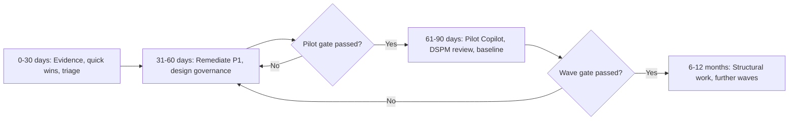

# Part 3: Microsoft 365 modernization and Copilot readiness assessment

## 1. Purpose, scope, and what this is / is not

**Purpose.** Describe how I would assess a Microsoft 365 (M365) tenant across identity, governance, SharePoint, Teams, OneDrive, Exchange Online, Microsoft Search, compliance, security and AI services (including Microsoft 365 Copilot), find the gaps, and recommend changes for scalability, security, adoption and future AI capability.

**What this is**

- An assessment framework: workstreams, evidence sources, scoring, a gap template, and a prioritised set of recommendations and a roadmap.
- Written from general M365 practitioner knowledge, plus the Microsoft pages listed in Section 9.

**What this is not**

- It is not an assessment of a real tenant. No tenant data was available. Every "common gap" below is a pattern to test for, not a finding. The one filled gap example in Section 5 is labelled ILLUSTRATIVE.
- It is not a statement that I have run this at a real organisation.
- It is not a current product-status reference. Microsoft changes names, licensing and preview status often. Statuses quoted here are "as of" the cited source date and are listed in Section 10 for re-verification. Anything I could not confirm is marked "confirm current status".

**Conventions.** ASSUMPTION marks a stated assumption. Numeric thresholds are "suggested starting targets" the organisation should set itself; none is a benchmark.

**Assumptions for the whole document**

- ASSUMPTION: commercial cloud tenant (not sovereign or 21Vianet, where several reports are documented as unavailable).
- ASSUMPTION: hybrid identity is likely (on-premises AD synced to Entra ID); the assessment confirms or rules it out in week 1.
- ASSUMPTION: Copilot licences are planned but not widely deployed. If already deployed, the oversharing work in Section 3.11 becomes urgent rather than preparatory.

---

## 2. Assessment approach

### 2.1 Stakeholders and RACI

R = does the work, A = accountable for the outcome, C = consulted, I = informed. Role names are generic; map them to the real organisation.

| Activity | Sponsor (exec) | M365 platform owner | Identity/security lead | Compliance/records/legal | Business unit owners | HR / works council (if relevant) | Change & comms lead |
|---|---|---|---|---|---|---|---|
| Scope, success criteria | A | R | C | C | C | I | I |
| Identity and security evidence | I | C | A/R | C | I | I | I |
| Content, site, Teams inventory | I | A/R | C | C | C | I | I |
| Compliance and retention review | I | C | C | A/R | C | C | I |
| Copilot data-readiness and oversharing triage | I | R | R | C | A for their sites | I | C |
| Adoption baseline and plan | C | C | I | I | C | C | A/R |
| Roadmap sign-off | A | R | R | R | C | I | C |

Note: in the oversharing triage, business-unit owners must decide what is appropriately shared. IT can find overshared content but cannot decide it is wrong.

### 2.2 Discovery workstreams

| # | Workstream | Question it answers |
|---|---|---|
| 1 | Identity and access | Who can sign in, from what, with what assurance, and who administers it? |
| 2 | Governance and lifecycle | Who owns each workspace, group and agent, and what happens when they leave or go stale? |
| 3 | Content platform (SharePoint, OneDrive, Teams) | Where does content live, who can reach it, is it findable? |
| 4 | Messaging (Exchange Online) | Is mail secure, authenticated and retained correctly? |
| 5 | Search and knowledge | Can people find authoritative content, and can Copilot ground on it safely? |
| 6 | Compliance and data protection | Is data classified, protected, retained and auditable? |
| 7 | Security operations and device posture | Are threats detected and devices trusted? |
| 8 | AI services and adoption | Are licences, data, controls, agents and users ready, and how will value be measured? |

### 2.3 Evidence sources and tooling

| Area | Tool or report | Use |
|---|---|---|
| Overall posture | Microsoft Secure Score (Defender portal) | Baseline score and improvement actions; treat as a prompt for investigation, not a grade |
| Identity | Entra admin center: sign-in logs, audit logs, Conditional Access policies and insights/reporting, authentication methods activity, PIM, access reviews, Identity Secure Score recommendations | Policy coverage, legacy auth, MFA method mix, privileged role assignments |
| Tenant inventory | Microsoft Graph and Microsoft Graph PowerShell (read-only scopes) | Scripted export of users, guests, groups, teams, apps/service principals, role assignments, licences |
| SharePoint | SharePoint admin center (active sites, sharing and access settings); SharePoint Advanced Management (SAM) reports, including data access governance reports (site permissions across the organization, sites shared with "Everyone except external users", sharing links, sensitivity label report) | Oversharing, site inventory, inactive sites |
| Exchange | Exchange Online PowerShell; Defender portal email and collaboration reports; DNS lookups for SPF/DKIM/DMARC | Mail flow, connectors, authentication, shared mailboxes |
| Compliance | Purview portal: Compliance Manager, Data Classification (content and activity explorer), DLP and retention policy reports, Audit, Insider Risk, Communication Compliance | Control coverage, label adoption, audit availability |
| AI risk | Purview Data Security Posture Management (DSPM) for AI | Copilot and AI-app interaction visibility, oversharing assessments |
| Security | Defender portal (Defender for Office 365, Endpoint, Identity, Cloud Apps), Intune admin center | Detection coverage, device compliance |
| Adoption | Microsoft 365 admin center usage reports and the Copilot usage/adoption analytics available in the tenant (confirm current names); Teams admin center analytics | Baseline and trend KPIs |
| Readiness guidance | Microsoft Copilot deployment blueprints on Microsoft Learn (oversharing blueprint, Section 9) | Structure for pillars: remediate oversharing, set up guardrails, meet regulations |

Access needed: read-only roles wherever possible (Global Reader, Security Reader, Reports Reader, Compliance roles scoped to read). Avoid using Global Administrator for discovery. Record who ran each export and when.

### 2.4 Sequencing (indicative)

ASSUMPTION: a mid-to-large tenant. The 4 to 6 week duration is indicative and scales with tenant size, hybrid complexity and access to data.

| Week | Activities |
|---|---|
| 0 | Agree scope, success criteria, access, evidence-handling rules (tenant data is sensitive), and stakeholder interviews calendar |
| 1 | Run read-only inventories (Graph, Exchange, SharePoint); collect Secure Score, Conditional Access and licence data |
| 2-3 | Domain deep dives; interviews; sample-based content review with business owners; sharing and permission reports |
| 4 | Score domains, write gap register, validate findings with owners (check for false positives) |
| 5 | Prioritise, draft recommendations and roadmap, agree dependencies |
| 6 | Readout, decision on Copilot rollout gates, handover of backlog |

### 2.5 Outputs

1. Current-state architecture summary and inventory baseline.
2. Scored maturity heatmap (Section 2.6).
3. Gap register (Section 4 template) with evidence references.
4. Prioritised recommendations and roadmap (Sections 6 and 7).
5. Copilot rollout gate checklist: the conditions under which each user wave may be licensed.
6. Adoption baseline and KPI definitions.

### 2.6 Maturity scoring model (0-4)

| Score | Name | Criteria |
|---|---|---|
| 0 | Absent | No control, policy or process exists, or it is unknown whether one does |
| 1 | Ad hoc | Control exists in places; not documented, not consistently applied, depends on individuals |
| 2 | Defined | Policy and standard exist and cover the majority of the estate, but enforcement or coverage has known holes and is measured only occasionally |
| 3 | Managed | Policy enforced by tooling across the in-scope estate; exceptions are tracked; reviewed on a schedule; owners are named |
| 4 | Optimised | As 3, plus automated detection of drift, metrics reviewed by management, and continuous improvement evidenced |

**Scoring rules**

- Each domain has 4 to 8 criteria (the rows in the Section 3 tables). Score each criterion 0-4 against the descriptions above.
- Domain score = the mean of its criterion scores, rounded to one decimal, **but** any criterion scored 0 or 1 that is marked "gating" (for example, break-glass accounts or MFA for admins in Identity) caps the domain at 2.0 regardless of the mean. This stops strong areas masking a critical hole.
- Tenant score is not averaged across domains. Report the heatmap by domain; a single number hides what matters.
- "Unknown" is scored 0 and flagged, because inability to evidence a control is itself a gap.

**Evidence quality** (recorded per criterion, separate from the maturity score)

| Grade | Meaning |
|---|---|
| E1 | System-generated export or report, dated, reproducible (for example a Graph export or an admin center report) |
| E2 | Configuration screenshot or policy read by the assessor, dated |
| E3 | Statement from an owner, interview-only |
| E4 | Inferred or assumed, no direct evidence |

A finding supported only by E3/E4 evidence is labelled provisional in the register and gets a validation task. Roll-up: report, per domain, the share of criteria at each evidence grade next to the maturity score, so a reader can see how much of the score rests on interviews.

---

## 3. Per-domain assessment

Each table: what to inspect, evidence, common gaps (patterns to test for, not findings), target state. "(gating)" marks criteria that cap the domain score.

### 3.1 Identity (Microsoft Entra ID)

| Inspect | Evidence | Common gaps | Target state |
|---|---|---|---|
| Conditional Access (CA) coverage | Entra CA policies, CA insights/reporting, sign-in logs filtered by CA result and legacy authentication | Policies in report-only never enforced; exclusions that grew over time; legacy authentication still allowed; no policy for guests or for risky sign-ins | Baseline set covering all users and apps, exclusions documented and reviewed, legacy auth blocked, risk-based policies where licensed (gating) |
| Authentication strength | Authentication methods activity and registration reports | SMS/voice as primary method; admins not on phishing-resistant methods; low registration for passkeys/FIDO2/Windows Hello | MFA for all users; phishing-resistant methods (passkeys, FIDO2, certificate-based, Windows Hello for Business) required for admins and high-risk roles (gating for admin MFA) |
| Privileged access | Role assignments via Graph; PIM audit; count of permanent Global Administrators | Many standing privileged roles; no approval or time limits; shared admin accounts | Just-in-time roles through PIM, few permanent assignments, access reviews on privileged roles, separate admin accounts |
| Emergency (break-glass) accounts | Account inventory, CA exclusions, sign-in alerts | None, or only one; excluded from CA but never tested or monitored | At least two cloud-only accounts, strong credentials held offline, alerting on any sign-in, tested on a schedule (gating) |
| Hybrid identity | Entra Connect (or Cloud Sync) health, sync scope, staging server, last sync, on-prem AD hygiene | Unsupported or old sync version; stale objects synced; single sync server; unknown federation dependencies | Supported sync version with documented recovery, scoped sync, a decision on password hash sync/passthrough/federation, AD cleaned of stale objects |
| Guests / B2B | Graph export of guest users with last sign-in; external collaboration settings; access reviews | Guests never expire; anyone can invite; guests in many groups; no sponsor | Invitation limited to defined roles, guest access reviews, cross-tenant access settings defined, sponsor recorded |
| Workload identities | App registrations and service principals via Graph; credential expiry; consent grants | Secrets that never expire, owners who left, broad application permissions, user-consent to risky apps | Every app has an owner, short-lived credentials or managed identities, admin-consent workflow, periodic review |
| Device compliance | Intune compliance policies, CA "require compliant device" coverage | Unmanaged devices reach sensitive data; BYOD unaddressed | Compliant or managed device required for sensitive apps; session controls for unmanaged devices |

Baseline security mode is described in Source A as generally available for Microsoft 365 and Entra, with a simulation mode (as of the Dec 2025 post; confirm current status and what it enforces before recommending it).

### 3.2 Governance

| Inspect | Evidence | Common gaps | Target state |
|---|---|---|---|
| Ownership and lifecycle | Graph export of groups/teams: owners count, last activity, creation date; Entra group expiration policy; SharePoint admin center inactive sites | Ownerless groups; owners who left; no expiry; unclear who may create sites and teams | At least two owners per workspace; expiry or review cycle; ownerless handling procedure; documented provisioning model |
| Naming and classification | Group naming policy, sensitivity label usage on containers | Inconsistent names; no container labels | Naming policy plus container labels that drive privacy, external sharing and device access |
| Sprawl | Counts of sites, teams, groups against active users; inactive-site policies and reports | Many abandoned workspaces; duplicated sites | Inactive-site policy, archive path, request process for new workspaces where justified |
| Access reviews | Entra access reviews; SAM site access reviews | No reviews, or reviews without follow-through | Scheduled reviews for guests, privileged roles, and highest-risk sites; outcomes enforced |
| Operating model | Interviews, RACI, change process | No platform owner or governance board; policies exist on paper only | Named platform owner, governance forum, published standards, exception process |

### 3.3 SharePoint

| Inspect | Evidence | Common gaps | Target state |
|---|---|---|---|
| Information architecture | Site inventory, hub structure, navigation, interviews | Flat or arbitrary site structure; intranet and team sites mixed; no hubs or inconsistent hubs | Documented IA: communication sites for publishing, team sites for collaboration, hubs aligned to business structure |
| Permissions and oversharing | SAM data access governance reports (site permissions across the organization; sites shared with "Everyone except external users"; sharing links report); site permission report for a given user | "Everyone except external users" on sites; broad org-wide links; unique-permission sprawl; large groups on sensitive sites | Sensitive sites restricted to defined groups; org-wide sharing links limited by default; remediation tracked per site owner |
| Site lifecycle | SAM content management assessment and inactive-site reports | Stale sites remain discoverable and Copilot-groundable | Lifecycle policy: inactivity notices, read-only, archive, delete |
| Content types and metadata | Content type hub usage, column reuse, library structure | Everything in folders; inconsistent metadata; poor findability | Small set of managed content types and metadata for authoritative content; folders used sparingly |
| Sharing settings | Tenant and site sharing settings | Tenant setting more permissive than needed | Tenant default sharing level set deliberately; site-level exceptions via labels |
| Migration (if any) | Migration plan, source inventories, redirects, permissions mapping | Permissions flattened on migration; unneeded legacy content migrated | Migrate only content with a business or legal reason; map permissions deliberately |

Source A states that SAM is included with the Microsoft 365 Copilot licence, with the content management assessment, permission report for a given user and agent insight report GA, and catalog management in Public Preview (as of the Dec 2025 post). The data access governance reports page states these reports require SAM prerequisites, and describes a limited reporting entitlement for some Microsoft 365 E5 administrators (see page; confirm current licensing).

### 3.4 Teams

| Inspect | Evidence | Common gaps | Target state |
|---|---|---|---|
| Provisioning and lifecycle | Graph team inventory; Teams admin center; group expiry settings | Anyone creates teams; duplicates; no archive | Provisioning policy; templates; expiry and archive |
| Channels | Count of channels and private/shared channels per team | Many private channels with separate site collections nobody governs | Guidance for when to use private channels; owners assigned; private and shared channel sites included in permission reviews |
| External access and guests | Teams external access, guest settings; federation allow/block lists; Entra cross-tenant settings | Open federation with all domains; guest access broadly enabled | Intentional external-access model; allow-lists for sensitive partners; guest access reviews |
| Meetings and recordings | Meeting policies; recording and transcript storage; who can record | Recordings in uncontrolled locations; transcripts retained indefinitely | Recording/transcript policy aligned to retention and labelling; lobby and presenter defaults set |
| Retention | Purview retention policies for Teams chats and channel messages | No policy, or conflicting policies | Retention aligned to legal and records requirements |
| Apps governance | Teams app permission and setup policies; app catalogue | All third-party apps allowed; custom apps unreviewed | Approved apps list; review of app permissions; custom app submission process |

Restricted Access Control on a team-connected site does not automatically apply to its private or shared channel sites, and external participants in shared channels from another tenant are not evaluated against it (per the RAC page, Section 9).

### 3.5 OneDrive

| Inspect | Evidence | Common gaps | Target state |
|---|---|---|---|
| Sync and Known Folder Move (KFM) | OneDrive admin center sync reports, Intune policy, KFM adoption | Desktop/Documents not redirected; unsupported sync clients; sync problems unmeasured | KFM enabled and enforced for managed devices; sync health monitored |
| Sharing defaults | OneDrive sharing settings; sharing links report | Default link type is organisation-wide or "Anyone" | Default link is "Specific people" (suggested; validate against business need); link expiry set |
| Departed users | Retention-for-deleted-users setting; manager access process; offboarding process | OneDrive deleted too soon, or kept forever without owner | Defined retention period, manager access, and legal-hold interaction |
| Storage and cleanup | OneDrive usage reports | Large personal archives; personal OneDrives holding records | Guidance on where business records belong; labels/retention for personal content where required |

Note: the RCD page states Restricted Content Discovery is not supported for OneDrive sites. The RAC page says Restricted Access Control can apply to OneDrive. Check both pages for current scope.

### 3.6 Exchange Online

| Inspect | Evidence | Common gaps | Target state |
|---|---|---|---|
| Mail flow and connectors | Exchange Online PowerShell (`Get-InboundConnector`, `Get-OutboundConnector`, transport rules); message trace | Unused connectors; broad transport rules; unknown third-party gateways | Documented connectors with owners; unused ones removed |
| Threat protection | Defender for Office 365 policy configuration; preset security policies; Defender portal reports | Defaults only; no Safe Links/Attachments where licensed; impersonation protection not set | Standard or Strict preset policies applied deliberately; priority accounts defined |
| Email authentication | DNS records for SPF, DKIM per domain; DMARC policy and reports | No DMARC, or `p=none` permanently; DKIM not enabled; parked domains unprotected | SPF and DKIM aligned; DMARC moving to quarantine/reject after monitoring; parked domains with reject policy |
| Shared mailboxes and permissions | Exchange PowerShell permission reports (Full Access, Send As) | Shared mailboxes with direct sign-in enabled; stale delegates | Sign-in blocked for shared mailboxes; delegate review |
| Retention and archiving | Retention policies, litigation hold, archive mailboxes | Holds applied with no review; inconsistent policy | Retention aligned to records schedule |
| Hybrid leftovers | Hybrid configuration wizard status; on-premises Exchange still used for attribute management | Hybrid server kept for recipient management without a plan | Decision documented: keep a supported management server or remove after cleanup, per Microsoft's guidance (confirm current guidance) |

### 3.7 Microsoft Search

| Inspect | Evidence | Common gaps | Target state |
|---|---|---|---|
| Authoritative content findability | Search usage and query reports in the Microsoft 365 admin center (Search & intelligence); sample queries by role | Policies and forms found only through duplicates or old copies | Authoritative sources identified; stale copies removed or archived |
| Bookmarks, acronyms, Q&A | Admin center Search & intelligence settings | None configured, or owners left | Curated bookmarks and acronyms for top queries; owners and review cycle |
| Connectors | Connectors list and status; item counts; permission model per connector | Connectors indexing data with broad access; no owner; failing crawls | Each connector has an owner, access model (see below), and monitoring |
| Verticals and scopes | Search verticals and result types | Default only | Verticals for key sources where justified |
| Relevance of intranet content | Page metadata, freshness, ownership | No page owner or review date | Review cycle on pages; ownership recorded |

**Naming.** Microsoft's documentation uses both "Microsoft Graph connectors" and "Microsoft 365 Copilot connectors" (the extensibility page I opened uses the first; the prebuilt connectors page uses the second). I treat them as the same capability under a name in transition; confirm current naming. Neither page I opened describes how access control on ingested items is enforced, so I rely on general knowledge that connector items carry access control lists set at ingestion, and the assessment must verify this per connector (ASSUMPTION). The extensibility page notes admins must enable inline results for connector content to appear in Search and Copilot (Search & intelligence > Customizations > Verticals).

### 3.8 Compliance (Microsoft Purview)

| Inspect | Evidence | Common gaps | Target state |
|---|---|---|---|
| Sensitivity labels | Purview label policies; label usage in content explorer/activity explorer; SAM sensitivity label report | Labels defined but few applied; too many labels; no container labels | Small label taxonomy; default labels; auto-labelling for high-confidence types; encryption where justified |
| DLP | DLP policies and reports; incident volume; policy mode (test vs enforce) | All policies in test mode forever; no Teams/endpoint coverage | Enforced policies for priority data types; tuned false positives; owners for incidents |
| Retention and records | Retention policies and labels; records management; disposition reviews | Conflicting or missing policies; no records schedule | Policy aligned to a records schedule; disposition process |
| eDiscovery | Case inventory; hold list; roles | Holds never released; no process | Documented process; holds reviewed |
| Insider Risk and Communication Compliance | Policies, triggers, privacy/pseudonymisation settings, roles | Not configured, or configured without HR and legal agreement | Scoped policies with privacy design agreed with HR/legal and works council where applicable |
| Audit | Audit status and retention; Compliance Manager assessments | Audit not enabled for needed workloads or retention too short for investigations | Audit enabled; retention set to investigation needs (licence-dependent; confirm) |

### 3.9 Security

| Inspect | Evidence | Common gaps | Target state |
|---|---|---|---|
| Detection and response | Defender portal incidents, coverage of Endpoint, Identity, Office 365, Cloud Apps; Secure Score actions | Products licensed but not onboarded; alerts without a responder | Onboarded sensors, defined triage and response owners |
| Device management | Intune enrolment and compliance reports | Unmanaged corporate devices; compliance policies not tied to CA | Compliance feeds CA; baseline configuration profiles |
| Zero Trust posture | Microsoft Zero Trust Assessment (referenced by the Copilot blueprint page) and Secure Score | Assessed once, then not revisited | Periodic assessment with tracked actions |
| App and OAuth governance | Defender for Cloud Apps/app governance; consent grants | Risky consented apps, no review | Admin-consent workflow; periodic review |

### 3.10 Cross-cutting note

Security and compliance findings feed the AI domain directly: Copilot respects the permissions a user already has, so oversharing, weak identity assurance and missing labels become AI exposure.

### 3.11 AI services and Microsoft 365 Copilot

| Inspect | Evidence | Common gaps | Target state |
|---|---|---|---|
| Licensing and eligibility | Licence assignment export via Graph; plan prerequisites | Licences allocated by seniority, not by use case; prerequisites unchecked | Licence waves by role/use case; prerequisites validated (confirm current requirements) |
| Data readiness and oversharing | SAM data access governance reports; site permission report for a user; Purview DSPM for AI assessments | Broad "Everyone except external users" access; org-wide links; stale sensitive sites | Oversharing triaged by site risk; high-risk sites remediated before wave 1 |
| Discoverability controls | Configuration of Restricted Content Discovery (RCD) and Restricted Access Control (RAC) on selected sites | Controls unused or used without an exit plan | RCD as a time-boxed control; RAC for genuinely restricted sites; remediation of root-cause permissions |
| Restricted SharePoint Search (RSS) | Tenant setting and allowed list | Used as the whole strategy | See note below: Microsoft documents RSS as retiring |
| DLP for Copilot | Purview DLP policies for the Copilot location | None configured | Sensitivity-label-based DLP for Copilot enforced; prompt-based DLP evaluated |
| DSPM for AI | Purview DSPM for AI dashboards and assessments | Not enabled; no owner | Enabled with defined review cadence |
| Agents and Copilot Studio | Agent inventory (admin center), Copilot Studio environment and data policies, connectors in use, SAM agent insight report | Makers create agents with broad connectors; ownerless agents; no review | Environment strategy, approved connectors, ownership, publishing approval |
| Agent identity | Entra Agent ID and Agent 365 controls | No identity or sponsor for agents | Each agent has an identity, a sponsor, access limited to need (confirm availability, Section 8) |
| Responsible AI and policy | Acceptable-use policy, risk assessment, transparency to users | Policy absent; users unsure what is permitted | Published policy; user guidance; escalation route for AI output concerns |
| Adoption measurement | Admin center usage and Copilot analytics (confirm names), survey, helpdesk themes | Licences assigned, no baseline, no value measures | Baseline before rollout; KPIs per wave (Section 7) |

**Statuses as of the Dec 2025 Ignite summary (Source A); confirm current status of each**

| Capability | Status in Source A |
|---|---|
| Purview DLP for Copilot using sensitivity labels (blocks Copilot processing of labelled files and emails) | Generally Available |
| Purview DLP for Copilot prompts (blocks responses when a prompt contains sensitive data) | Public Preview |
| DSPM for AI data risk assessments (item-level investigation, bulk remediation of overshared links) | Public Preview |
| SAM included with the Microsoft 365 Copilot licence: content management assessment, permission report for a given user, agent insight report | GA |
| SAM catalog management; delegating Restricted Access Control and Restricted Content Discovery to site admins; SharePoint Admin Agent | Public Preview |

**Restricted SharePoint Search.** The prompt framed RSS as an interim measure. The current Microsoft page I opened goes further: it says RSS is a short-term measure, not intended or scalable for long-term use, "isn't a security boundary", caps the allowed list at 100 sites, does not fully restrict results (recently accessed or shared sites still appear), and states "Starting July 31, 2026, new enablement is blocked." Given today's date, a tenant that does not already have it enabled cannot newly enable it (confirm on the live page). So my recommendation is to treat RSS only as something to retire if found, and to use RCD, RAC and permission remediation instead.

**Restricted Content Discovery (RCD)** per its page: limits discovery of a site's content in org-wide search and Copilot responses; does not change permissions, does not remove content from the index, does not apply to OneDrive, has propagation delay (more than a week for very large sites), and Microsoft describes it as a temporary governance control. **Restricted Access Control (RAC)** blocks access itself, including in search and Copilot, for users outside up to 10 specified groups, and requires both site permission and group membership.

---

## 4. Gap-analysis template

| Field | Guidance |
|---|---|
| ID | Domain prefix + number (for example ID-03) |
| Current state | What was observed, with date |
| Target state | The agreed standard |
| Gap | The difference, stated factually |
| Risk | Impact and likelihood, in business terms (High/Med/Low with one-line rationale) |
| Effort | S (days), M (weeks), L (months), plus dependencies |
| Priority | P1 before any Copilot wave; P2 within 90 days; P3 roadmap |
| Owner | A named role, not a team alias |
| Evidence | Report/export name, date, evidence grade (E1-E4) |

**ILLUSTRATIVE example only. Not a finding. No tenant data was assessed.**

| Field | Illustrative entry |
|---|---|
| ID | SP-07 |
| Current state | (Hypothetical) The data access governance "Site permissions across your organization" report lists several finance sites with "Everyone except external users" in the access list. Evidence E1 |
| Target state | Finance sites accessible only to named finance groups; sensitivity label applied at site level |
| Gap | Org-wide access to sites that hold payroll and budget documents |
| Risk | High: any licensed Copilot user could be given responses grounded in this content; also exposes content in ordinary search |
| Effort | M: site-owner validation, permission cleanup, label rollout |
| Priority | P1: gate for Copilot wave 1 |
| Owner | Finance site owner (accountable), M365 platform owner (responsible) |
| Evidence | SAM data access governance report snapshot, dated; owner confirmation (E3) |

---

## 5. Recommendations

Quick wins can start in the first 30 days with little dependency. Structural changes need design, owners and time.

### 5.1 Security

| # | Recommendation | Type | Depends on | Trade-off or risk |
|---|---|---|---|---|
| S1 | Verify break-glass accounts; require phishing-resistant MFA for admins; remove standing privileged roles via PIM | Quick win / structural | PIM licensing (confirm) | Lock-out risk if exclusions are wrong; test first |
| S2 | Run CA changes in report-only, review impact in sign-in logs, then enforce; block legacy authentication | Quick win | Sign-in log review | Breaks old mail clients and scripts; communicate |
| S3 | Evaluate Baseline security mode in simulation (Source A: GA with simulation mode, as of Dec 2025) | Quick win | Confirm current status and settings | May conflict with existing policies |
| S4 | DMARC from monitor to enforce, DKIM on all domains | Structural (weeks) | DNS owners, inventory of senders | Legitimate third-party senders blocked if missed |
| S5 | Guest lifecycle: sponsor, expiry, access reviews | Structural | Governance model | Business friction with partners |
| S6 | Workload identity hygiene: owners, credential expiry, consent review | Structural | App inventory | Outages when expired secrets are rotated |

### 5.2 Scalability

| # | Recommendation | Type | Depends on | Trade-off or risk |
|---|---|---|---|---|
| C1 | Define and publish provisioning model (who creates sites, teams, groups; templates; naming) | Structural | Governance forum | Slower self-service if over-controlled |
| C2 | Ownership and lifecycle: two owners, expiry, inactive-site handling, archive | Structural | Owner data from Graph | Deleted workspaces people still need; use read-only first |
| C3 | Target IA: hubs, communication vs team sites, managed metadata for authoritative content | Structural | Business engagement | Large effort; prioritise high-value content |
| C4 | Standardise OneDrive (KFM, sharing defaults, departed-user process) | Quick win / structural | Intune | User disruption on KFM rollout |
| C5 | Automate inventory and drift reports with Graph and SAM so governance is not a one-off | Structural | Service identity with read scopes | Needs an owner and maintenance |
| C6 | Migration discipline: migrate only what is needed, map permissions explicitly | Structural | Content owners | Slower migration |

### 5.3 User adoption

Adoption is a change-management problem as much as a technical one.

| # | Recommendation | Detail |
|---|---|---|
| A1 | Champions network | Volunteers per business unit, given early access, a feedback route, and time allocated by their managers |
| A2 | Role-based training | Short scenario-based sessions by role (for example, meeting follow-up for managers) rather than generic feature tours |
| A3 | Use cases first | Pick a small number of measurable scenarios per department before assigning licences |
| A4 | Communicate boundaries | What Copilot can see (what the user can already access), what is permitted, how to report bad output |
| A5 | Feedback loop | Surveys and helpdesk themes reviewed fortnightly; adjust guidance |
| A6 | Measure | KPIs below; baseline first |

Suggested KPIs (the organisation sets its own targets; none are benchmarks): active users of target apps as share of licensed users; return use over several weeks; self-reported time savings from a short survey (treat as perception, not proof); helpdesk tickets per topic; champion participation; share of licences reassigned from inactive users; sensitive-data incidents involving Copilot.

### 5.4 Future AI capabilities

| # | Recommendation | Type | Depends on | Trade-off or risk |
|---|---|---|---|---|
| AI1 | Oversharing remediation before broad rollout: SAM reports, site-owner review, fix permissions, label high-risk sites | Structural | Owners available; SAM | Slower start; the cost of not doing it is exposure |
| AI2 | Use RCD temporarily for sites that cannot be fixed before rollout; RAC for sites that must be restricted; record an exit date and owner for every RCD exception | Quick win with exit | SAM; Copilot licence | Excess use reduces search and Copilot completeness (RCD page); not a fix for permissions |
| AI3 | If RSS is already enabled, plan its retirement; do not design around it | Quick win | Confirm current status | Wider exposure when removed if permissions not fixed |
| AI4 | Label-based DLP for Copilot, then evaluate prompt-based DLP when status allows | Structural | Label taxonomy | Preview features can change |
| AI5 | Enable DSPM for AI and review risk assessments on a cadence | Quick win | Purview roles; licensing (confirm) | Alert volume; assign owner |
| AI6 | Agent governance: owner required, approved connectors, environment strategy in Copilot Studio, agent inventory | Structural | Governance forum | Slows makers; balance with a fast-lane for low-risk agents |
| AI7 | Adopt agent identity and governance controls where available (Section 8) | Structural | Licensing and availability | Confirm status |
| AI8 | Curate knowledge: authoritative sources, retire stale content, connectors with correct access control | Structural | IA work | Ongoing effort |

### 5.5 Key trade-offs

- **Permissions before rollout vs momentum.** Fixing every permission before any Copilot use may stall the programme. A workable compromise: define P1 gating criteria (high-risk sites remediated or restricted; admin MFA; DLP baseline), license a small pilot population whose accessible content has been checked, and widen in waves as gates are met. The risk is that the pilot reveals exposure it was not designed to find; plan an incident route.
- **RCD/RAC are controls, not a strategy.** They reduce exposure quickly but do not fix root causes, and over-use shrinks what Copilot and search can find.
- **Strict labelling vs usability.** Too many labels or mandatory labelling too early drives workarounds.
- **Centralised vs federated governance.** Central control reduces risk but slows teams; federate low-risk decisions to site owners with guardrails.
- **Preview features.** Useful for planning; do not make a compliance commitment depend on a preview.

---

## 6. Roadmap

Gates and KPI values are suggested starting targets for the organisation to set, not benchmarks.

| Phase | Focus | Entry criteria | Exit criteria | KPIs |
|---|---|---|---|---|
| 0-30 days | Evidence and quick wins: inventories, Secure Score and CA review, break-glass check, DMARC monitoring, SAM reports run, oversharing triage list | Sponsor approval; read-only access granted | Gap register v1 with evidence grades; P1 list agreed; admin MFA plan | Share of criteria with E1/E2 evidence; number of P1 gaps; admin accounts on phishing-resistant methods |
| 31-60 days | Remediate P1: top-risk sites, privileged access, CA enforcement; governance model drafted; DLP/label design; pilot cohort chosen | P1 list agreed; owners named | P1 items closed or formally risk-accepted; pilot gate checklist passed | P1 closure rate; high-risk sites remediated or restricted; legacy auth sign-ins trend |
| 61-90 days | Pilot Copilot with champions; DSPM for AI review cadence; agent governance baseline; adoption baseline survey | Pilot gate passed | Pilot review: incidents, usage, feedback; decision on wave 2 | Pilot active-use share; incidents; survey results; helpdesk themes |
| 6-12 months | Structural: lifecycle automation, IA improvements, label rollout and auto-labelling, retention alignment, further waves, agent identity controls, retire RCD exceptions | Wave gate per wave | Governance running as routine; RCD exceptions retired or justified; drift reports automated | Waves completed; RCD exceptions open; label coverage on sensitive sites; stale-site share; adoption trend |

---

## 7. How this connects to the agent architecture

Part 2 is in `docs/architecture-service-management.md`. I refer to it by path only and do not restate it here.

**Same principles.** The agent in Part 2 should inherit the identity and security-trimming principles that Copilot depends on: act as or on behalf of an authenticated user, never widen access, and honour the source's permissions at query time. A tenant with oversharing problems will expose the same content to a custom agent as to Copilot, so the remediation here is a precondition for both. Audit, labels and DLP apply to both.

**Extend Copilot, Copilot Studio or connectors vs build custom.**

| Option | Fits when | Strengths | Trade-offs |
|---|---|---|---|
| Microsoft 365 Copilot with connectors (Graph/Copilot connectors) | The content is searchable knowledge and users already have Copilot | Reuses Microsoft's grounding, permission trimming and admin controls; least build effort | Limited control of retrieval, orchestration and evaluation; connector access control must be verified; depends on licences |
| Copilot Studio agent | Process-oriented agent with moderate logic, makers outside engineering | Faster delivery; integrated governance and the Microsoft admin surface | Less control over orchestration and testing; platform limits and licensing (confirm) |
| Custom agent (as in Part 2) | Need for specific workflows, evaluation, multi-system integration, or non-Microsoft hosting | Full control of retrieval, evaluation, logging, cost and portability | Own the security, identity, maintenance and compliance work; must reproduce trimming and audit |

A reasonable default (a design opinion, not a rule): start with the Microsoft-managed option when it meets the requirement, and build custom where evaluation, control or cross-system workflow justify the cost.

**Agent identity and governance.** The Microsoft Learn page on Entra capabilities for Agent 365 (Source B, last updated 2026-05-12) describes Microsoft Entra Agent ID as the identity platform for Agent 365: agent identities, sponsorship/ownership, lifecycle workflows, Conditional Access for agents, ID Protection for agents, and Secure Web and AI Gateway network controls for Copilot Studio agents. That page does not state availability, licensing or preview status of those features, and I do not guess. The Agent 365 overview page I opened states that Agent 365 is generally available for the Commercial segment on a per-user basis, and that it works best with Microsoft E5 as a prerequisite; it does not give prices (confirm current status and licensing before committing). For any agent introduced: give it its own identity, record a sponsor, grant least privilege, apply CA where supported, keep it in the agent inventory, and review it on a schedule. Whether the Part 2 agent can register in that governance plane depends on how it is hosted and authenticated (ASSUMPTION; confirm).

---

## 8. Availability questions to settle early

- Is Entra Agent ID available and licensed in this tenant, and which of its controls apply to non-Microsoft agents?
- Which preview features in Section 3.11 have since reached GA or changed?
- Does the licence in place cover SAM, DSPM for AI, PIM, Insider Risk and extended audit retention?

---

## 9. Sources (pages actually opened)

1. Security and governance innovations for Microsoft 365 Copilot (Dec 2025 post, Source A), opened on 2026-11-19: https://techcommunity.microsoft.com/t5/microsoft-365-copilot-blog/security-and-governance-innovations-for-microsoft-365-copilot/ba-p/4476172
2. Microsoft Entra capabilities for Agent 365 (Source B, page last updated 2026-05-12), opened on 2026-11-19: https://learn.microsoft.com/en-us/microsoft-agent-365/admin/capabilities-entra
3. Restricted SharePoint Search: https://learn.microsoft.com/en-us/sharepoint/restricted-sharepoint-search
4. Restrict discovery of SharePoint sites and content (Restricted Content Discovery): https://learn.microsoft.com/en-us/sharepoint/restricted-content-discovery
5. Restricted access control: https://learn.microsoft.com/en-us/sharepoint/restricted-access-control
6. Data access governance reports: https://learn.microsoft.com/en-us/sharepoint/data-access-governance-reports
7. Overview of Microsoft Agent 365: https://learn.microsoft.com/en-us/microsoft-agent-365/overview
8. Microsoft 365 Copilot blueprint for oversharing (page metadata: last updated 2026-11-13): https://learn.microsoft.com/en-us/copilot/microsoft-365/microsoft-365-copilot-blueprint-oversharing
9. Secure and govern Microsoft Copilot: foundational deployment guidance: https://learn.microsoft.com/en-us/microsoft-365/copilot/secure-govern-copilot-foundational-deployment-guidance
10. Microsoft Graph connectors for Microsoft 365 Copilot (extensibility overview): https://learn.microsoft.com/microsoft-365-copilot/extensibility/overview-graph-connector
11. Prebuilt connectors, Microsoft 365 Copilot connectors: https://learn.microsoft.com/en-us/microsoft-365/copilot/connectors/prebuilt-connectors-overview
12. Training unit "Choose the right control for the job" (only metadata was readable; used just to confirm that RCD, RAC and RSS are compared and that RSS retirement is accounted for): https://learn.microsoft.com/en-us/training/modules/govern-sharepoint-onedrive-copilot/9-choose-right-control

A Tech Community post on mitigating oversharing (4448744) returned an empty page and is not cited.

Everything not tied to a source above (Conditional Access, PIM, Defender for Office 365, DMARC, Known Folder Move, retention, eDiscovery, Insider Risk, labels and the like) is general practitioner knowledge, not verified from a page opened for this document.

---

## 10. Claims to re-verify before presenting

1. Status of every Source A item (Dec 2025): DLP for Copilot prompts; DSPM for AI data risk assessments; SAM catalog management; delegated RAC/RCD to site admins; SharePoint Admin Agent; Baseline security mode behaviour.
2. RSS retirement: new enablement blocked from July 31, 2026, and what happens to tenants that already have it enabled.
3. RCD and RAC scope, OneDrive support, group limits (10 groups for RAC), propagation times, and licensing (SAM prerequisites).
4. SAM entitlement with the Copilot licence, and the E5 admin reporting limitation described on the data access governance page.
5. Agent 365: GA status, licensing and E5 prerequisite; which Entra Agent ID controls (agent identities, sponsors, CA for agents, ID Protection for agents, network controls) are available and for which agent types. Source B states no status.
6. Connector naming ("Microsoft Graph connectors" vs "Microsoft 365 Copilot connectors") and how access control lists are enforced on ingested items.
7. Names of the Copilot usage and adoption analytics in the admin center and Viva-related reports.
8. Licensing for PIM, Insider Risk, Communication Compliance, extended audit retention, Defender for Office 365 plans, and DSPM for AI.
9. Current Microsoft guidance on retaining on-premises Exchange for recipient management in hybrid.
10. Which Purview and Defender portal features have been renamed or moved since the sources were published.
